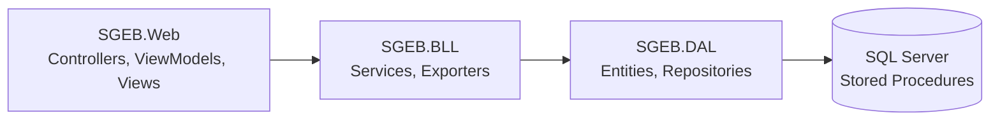
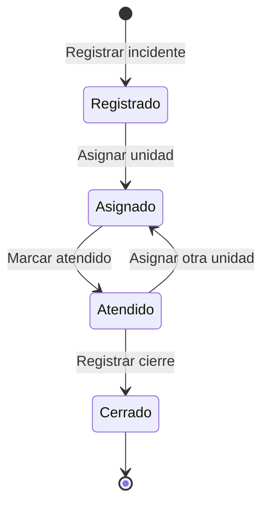

## Tabla de módulos por capa

Una fila por módulo, con sus archivos en Web, BLL y DAL.

| Módulo | Entidad (DAL) | Repository (DAL) | Service (BLL) | Controller / ViewModels / Vistas (Web) |
|---|---|---|---|---|
| Incidentes | `Incidente`, `Reportante` | `IncidenteRepository`... | `IncidenteService`... | `IncidenteController`... |
| Unidades | `Unidad` | `UnidadRepository` | `UnidadService` | `UnidadController`... |
| Asignación | `IncidenteUnidad` | `IncidenteUnidadRepository` | `IncidenteUnidadService` | `IncidenteUnidadController`... |
| Atención/Cierre | `AtencionCierre` | `AtencionCierreRepository` | `AtencionCierreService` | `AtencionCierreController`... |
| Reportes | `EstadisticaTipo/Zona` | `ReporteRepository` | `ReporteService` + Exporters | — |

## Arquitectura en 3 capas 

## Diagrama de estados del incidente 

## Tabla de códigos de error

| Código | Origen | Significado |
|---|---|---|
| 50001 | `sp_IncidenteUnidad_Asignar` | La unidad no está disponible |
| 50002 | `sp_IncidenteUnidad_Asignar` | El incidente ya está cerrado |
| 50003 | `sp_IncidenteUnidad_Liberar` | La asignación no existe o ya fue liberada |
| 50010 a 50014 | `sp_Incidente_MarcarAtendido` | No existe, cerrado, sin unidad, ya atendido, sin unidades activas |
| 50020 a 50022 | `sp_Unidad_ActualizarEstado` | “En servicio” manual, estado inválido, unidad inexistente |
| 2627 / 2601 | SQL Server | Código de unidad repetido (lo traduce `UnidadService`) |